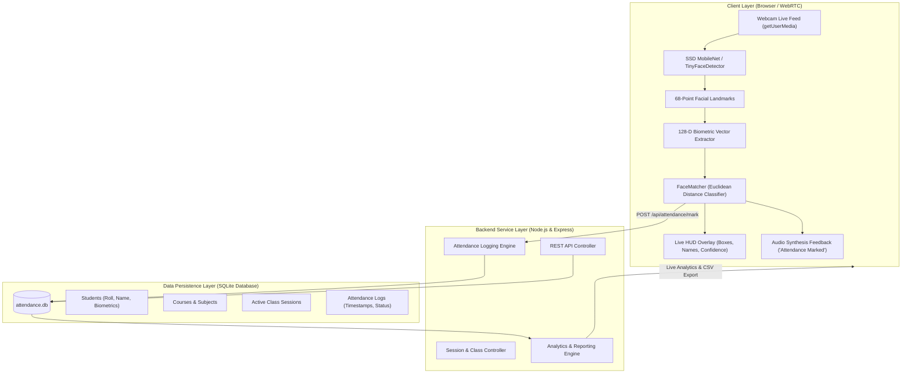
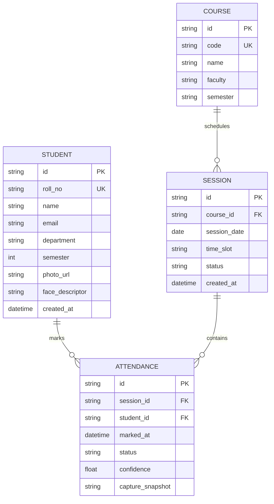

# Live Attendance Monitoring System: MCA Project Implementation Plan

## 1. Project Overview & Academic Significance
The **Live Attendance Monitoring System** is an AI-powered, real-time computer vision web application designed to automate, streamline, and secure classroom/institution attendance. Built for an **MCA (Master of Computer Applications)** capstone/course project, the system demonstrates proficiency in:
- **Computer Vision & Deep Learning**: Real-time multi-face detection, 68-point facial landmark regression, and 128-dimensional biometric feature embeddings matching using Euclidean distance.
- **Full-Stack Web Engineering**: Clean separation of client-side biometric processing (zero server GPU bottleneck, high FPS) and RESTful backend data services.
- **Academic Rigor**: Complete relational database schema, session management, anti-spoofing liveness indicators, audit logging, and reporting/analytics.

---

## 2. High-Level System Architecture



---

## 3. Technology Stack Justification

| Layer | Technology | Justification for MCA Evaluation |
|---|---|---|
| **Frontend UI** | HTML5, Vanilla Modern CSS (Glassmorphic Dark Theme), ES6+ JavaScript | Adheres to strict performance standards; stunning responsive UI with zero bloated dependencies; direct hardware webcam stream access via HTML5 Video and Canvas. |
| **Vision & AI Engine** | `face-api.js` (TensorFlow.js WebGL backend) | Executes client-side deep neural network inference using client WebGL shaders. Instant 30+ FPS performance without requiring costly GPU servers or tricky native Windows C++ compiler bindings. |
| **Backend API** | Node.js (v24 LTS) + Express.js | High-throughput asynchronous event-driven server handling real-time attendance ingestion, session control, and analytics. |
| **Database** | SQLite3 / Embedded JSON Relational Store | Zero configuration, ACID-compliant relational persistence with fast query capability, ideal for self-contained academic defense demonstrations. |
| **Audio/Haptics** | Web Speech Synthesis API & Web Audio API | Provides audible confirmation upon successful recognition, elevating user experience and demonstration impact. |
| **Export Formats** | CSV / Excel Data Exporter | Generates institutional attendance sheets with summary metrics (Present, Absent, Attendance Percentage). |

---

## 4. Key Functional Modules

### Module 1: Student Enrollment & Biometric Profiling
- Capture student bio-data: Roll No, Full Name, Department, Semester, Section, Contact Email.
- Real-time webcam snapshot capture or photo upload.
- Automated extraction of 128-point face descriptor vector and storage in the database.
- Visual thumbnail preview with face detection verification box.

### Module 2: Live Camera Attendance Scanner (Live HUD)
- Real-time webcam feed with dynamic canvas HUD overlay.
- Multi-face tracking: highlights unknown faces in amber/red and recognized enrolled students in bright emerald green with name tag and confidence score.
- Auto-Attendance Trigger: Once confidence exceeds 85% ($Euclidean\ Distance \le 0.50$), logs attendance instantaneously.
- Duplicate Cooldown Logic: Prevents duplicate attendance logging within the same session.
- Live audio announcement: *"Attendance marked for Mohd. Shad, Roll 101"*.

### Module 3: Active Class Session Management
- Select or create course sessions (e.g., *MCA-401 Machine Learning*, *MCA-402 Cloud Computing*).
- Faculty selection, lecture slot, and date.
- Real-time session status (Active, Completed, Paused).

### Module 4: Real-Time Attendance Monitoring Dashboard
- Live metric cards:
  - Total Enrolled Students
  - Present Today
  - Absent Count
  - Live Attendance Rate (%)
- Real-time attendance event stream / live activity ticker.
- Manual status override (Present, Late, Excused) by faculty.

### Module 5: Analytics, Attendance Reports & CSV Export
- Student-wise attendance profile with aggregate percentage badge ($\ge 75\%$ eligible, $< 75\%$ shortage alert).
- Date-range and subject-wise filtering.
- One-click CSV export ready for college administrative records.

### Module 6: MCA Project Academic Showcase & Documentation
- Built-in documentation tab presenting Project Abstract, Data Flow Diagram (DFD Levels 0, 1, 2), System Specifications, and Viva Q&A Cheat Sheet.

---

## 5. Database Schema (Relational Design)



---

## 6. Project Directory Structure

```
live-attendance/
├── package.json               # Node.js project manifest & scripts
├── server.js                  # Express REST API, SQLite backend & static server
├── db.js                      # Database schema, migrations & seed data
├── public/
│   ├── index.html             # Single-Page Dashboard & Scanner UI
│   ├── css/
│   │   └── style.css          # Premium Glassmorphic Dark UI & animations
│   ├── js/
│   │   ├── app.js             # Navigation, State Management & Event Handling
│   │   ├── scanner.js         # WebRTC Camera & Face-API Real-Time Pipeline
│   │   ├── enrollment.js      # Student Registration & Embedding Generator
│   │   ├── dashboard.js       # Live Analytics, Session Mgmt & Attendance Log
│   │   └── audio.js           # Audio Feedback & Speech Synthesis
│   ├── models/                # Pre-trained deep learning weight files
│   │   ├── tiny_face_detector/
│   │   ├── face_landmark_68/
│   │   └── face_recognition/
│   └── uploads/               # Student photo thumbnails & attendance snapshots
└── README.md                  # Academic Project Report, Run Instructions & Viva Guide
```

---

## 7. Implementation Roadmap & Milestones

1. **Phase 1: Environment Setup & Project Foundation** (Node.js backend, SQLite database schema, REST API routes).
2. **Phase 2: Deep Learning Model Weights & Biometric Assets Integration** (Client-side face-api models and WebGL pipeline).
3. **Phase 3: Student Enrollment Engine with Biometric Descriptors** (Webcam registration, 128-D vector extraction, database persistence).
4. **Phase 4: Real-time Live Camera Scanner with HUD** (WebRTC feed, multi-face tracking, matching algorithm, automated attendance trigger, audio chime).
5. **Phase 5: Real-time Dashboard, Analytics & Session Control** (Live counters, session selector, shortage alerts, manual override).
6. **Phase 6: Reporting & Export Engine** (CSV export, date filtering, student attendance records).
7. **Phase 7: Academic Documentation & Viva Preparation Suite** (DFD, System Architecture, Viva Q&A).
8. **Phase 8: End-to-End Verification with Headless Browser Testing** (Verify camera, enrollment, recognition, reports).
